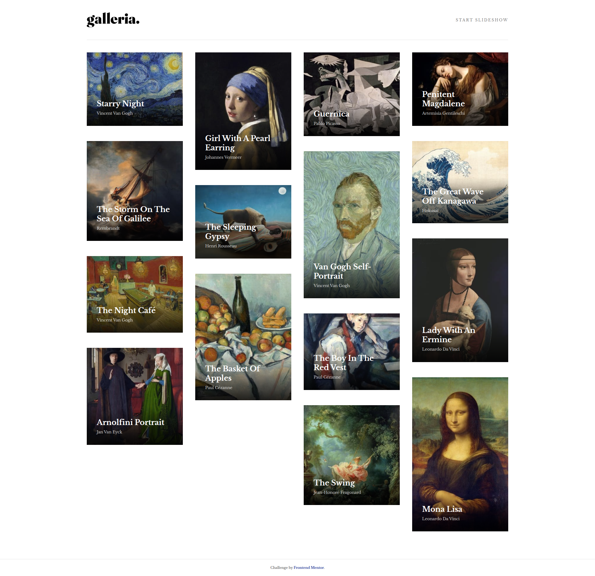

# Frontend Mentor - Galleria slideshow site solution

This is a solution to the [Galleria slideshow site challenge on Frontend Mentor](https://www.frontendmentor.io/challenges/galleria-slideshow-site-tEA4pwsa6).

## Overview

This is a landing page for a gallery slideshow site challenge. On this site users can:

- View the optimal layout for the app depending on their device's screen size
- See hover states for all interactive elements on the page
- Navigate the slideshow and view each painting in a lightbox

### Screenshot

### Links

- https://biruchenko.github.io/gallery-slideshow-site/

### Built with

- Semantic HTML5 markup
- SCSS (Sass) — compiled to CSS
- Flexbox
- CSS Grid
- Vanilla JavaScript (DOM manipulation)
- BEM methodology
- Mobile-first workflow
- Isotope for masonry grid

### What I learned

This challenge pushed me into a learning process beyond basic DOM manipulation, covering client-side routing, scroll-state management, and masonry layout.

#### URL-driven navigation with the History API

I used `history.pushState()` to update the URL with `?detail=<index>` when opening a painting, so users can bookmark or share a direct link to a specific piece. On load, `fetchData()` reads that parameter via `URLSearchParams` and opens the matching detail view without a page reload.

#### Handling browser back/forward with `popstate`

The `popstate` event fires when the user navigates through history. I listen for it to restore the correct view (gallery or detail) based on the current URL, and to close the image lightbox if it's open. I also set `history.scrollRestoration = 'manual'` and persist scroll positions in `sessionStorage` so returning to the gallery puts the user back where they left off.

#### Masonry grid with Isotope

I built the painting grid using Isotope, initializing it only after images load (via `imagesLoaded`) so brick positions are calculated correctly. A `.grid-sizer` element defines the column width, and I call `iso.layout()` when switching views and on a debounced resize to keep the grid aligned.

## Acknowledgments

- Challenge by [Frontend Mentor](https://www.frontendmentor.io).
